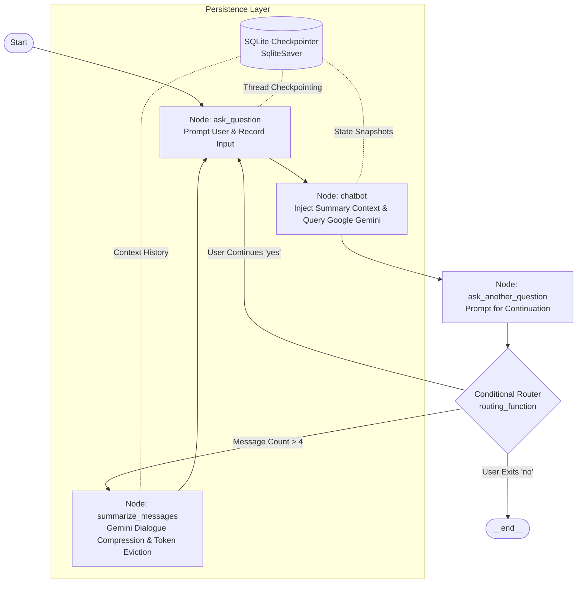

# Stateful AI Agent Architecture & Persistent Memory with LangGraph & Google Gemini

[](https://www.python.org/)
[](https://github.com/langchain-ai/langgraph)
[](https://github.com/langchain-ai/langchain)
[](https://ai.google.dev/)
[](https://www.sqlite.org/)
[](LICENSE)

A production-grade, stateful AI agent architecture engineered with **LangGraph**, **LangChain**, **Google Gemini**, and **SQLite**. This project demonstrates how to build resilient, multi-turn AI systems with dynamic context condensation (token-saving conversational summarization), persistent thread checkpointers, conditional cyclic routing, and time-travel state auditing.

---

## 🌟 Architectural Highlights & Core Capabilities

- **🧠 Stateful Cyclic Graph Execution**: Replaces rigid, linear LLM chains with a dynamic cyclic state machine (`StateGraph`) built on typed state schemas.
- **⚡ Dynamic Context Condensation & Token Optimization**: Monitors active conversational depth; when history exceeds threshold boundaries, an autonomous node condenses dialogue into a cumulative summary and evicts historical messages using `RemoveMessage` to drastically reduce context window consumption and API costs.
- **✨ Google Gemini Integration**: Leverages `ChatGoogleGenerativeAI` for fast reasoning and semantic summarization with configurable models (`gemini-2.5-flash`, `gemini-3.5-flash-lite`, etc.).
- **💾 ACID-Compliant Persistent Memory**: Implements thread-isolated state persistence via `SqliteSaver`, enabling session checkpointing, resilience to interruptions, and multi-user thread separation (`thread_id`).
- **🔀 Autonomous Conditional Routing**: Dynamic branch decision-making that evaluates user intent and conversation volume to dynamically steer between continuous dialogue, context summarization, or graceful termination.
- **⏳ Time-Travel Auditing & State Inspection**: Full replayability and auditing of conversational states across execution steps using `get_state_history()`, allowing developers to inspect state transitions and checkpoint values at any point in time.

---

## 🏗️ System Architecture & Workflow



---

## 📂 Project Structure

```bash
02-langgraph-stateful-agents/
│
├── LangGraph_Stateful_Agents_Architecture.ipynb  # Comprehensive production notebook & state machine
├── requirements.txt                              # Pinned project dependencies
├── .env.example                                  # Environment template for Gemini API key
├── .gitignore                                    # Production gitignore for databases & secrets
└── README.md                                     # Project architecture & documentation
```

---

## 🛠️ Tech Stack & Primitives

| Component | Technology | Purpose |
| :--- | :--- | :--- |
| **Orchestration** | LangGraph (`StateGraph`, `MessagesState`, `add_messages`) | Stateful agent control flow and cyclic graph logic |
| **LLM Framework** | LangChain Core & Google GenAI | Message primitives (`HumanMessage`, `AIMessage`, `RemoveMessage`) |
| **Model** | Google Gemini (`ChatGoogleGenerativeAI`) | Fast reasoning, response generation, and dialogue distillation |
| **Persistence** | `SqliteSaver` / SQLite3 | Thread-isolated checkpointing and session management |
| **Validation** | Pydantic / TypedDict / Mypy | Static type checking and schema enforcement |

---

## 🚀 Getting Started

### 1. Clone the Repository
```bash
git clone https://github.com/burraq-e-mohammad/langgraph-stateful-agent-memory.git
cd langgraph-stateful-agent-memory
```

### 2. Create and Activate a Virtual Environment
```bash
# Windows (PowerShell)
python -m venv .venv
.venv\Scripts\Activate.ps1

# Linux / macOS
python3 -m venv .venv
source .venv/bin/activate
```

### 3. Install Dependencies
```bash
pip install -r requirements.txt
```

### 4. Configure Environment Variables
Create a `.env` file in the project root:
```bash
cp .env.example .env
```
Add your Google Gemini API key:
```env
GEMINI_API_KEY=your_gemini_api_key_here
GEMINI_MODEL=gemini-2.5-flash
```

### 5. Launch the Notebook
Run the Jupyter notebook in VS Code or via JupyterLab:
```bash
jupyter lab LangGraph_Stateful_Agents_Architecture.ipynb
```

---

## 🔍 Deep-Dive: Key Innovations Implemented

### 1. Resilient State Schema with Reducer Semantics
```python
class AgentState(MessagesState):
    """
    Comprehensive Agent State:
    - messages: Sequence[BaseMessage] managed by add_messages reducer
    - summary: str containing LLM-condensed context of earlier conversation
    """
    summary: str
```
By inheriting from `MessagesState`, the `messages` list automatically leverages the `add_messages` reducer to safely append incoming messages and handle message deletion via `RemoveMessage`.

### 2. Context Compression & Token Pruning with Gemini
```python
def summarize_messages(state: AgentState) -> AgentState:
    # Summarize older dialogue into a compact summary string using Gemini
    updated_summary = chat.invoke([HumanMessage(summary_prompt)])
    summary_text = getattr(updated_summary, "text", "") or str(updated_summary.content)
    
    # Evict messages that have been summarized using RemoveMessage
    remove_tokens = [RemoveMessage(id=msg.id) for msg in state["messages"] if hasattr(msg, "id") and msg.id]
    
    return AgentState(
        messages=remove_tokens,
        summary=summary_text
    )
```
This architecture prevents token overflow in long-running sessions by converting raw chat history into structured semantic memory.

### 3. Session Isolation & Time-Travel Debugging
```python
config_thread = {"configurable": {"thread_id": "session_001"}}
output_state = agent_app.invoke(AgentState(messages=[], summary=""), config=config_thread)

# Time-travel state auditing:
history = list(agent_app.get_state_history(config_thread))
for snapshot in history:
    print(f"Checkpoint: {snapshot.next} | State: {snapshot.values}")
```
Allows concurrent multi-tenant execution and historical playback of every execution state.

---

## 🔮 Future Roadmap
- [ ] Add Human-in-the-Loop (HITL) breakpoint approval before message eviction.
- [ ] Implement vector database retrieval (RAG) alongside episodic memory summary.
- [ ] Support PostgreSQL checkpointer (`PostgresSaver`) for distributed cloud production deployments.

---

## 📄 License
This project is licensed under the MIT License - see the [LICENSE](LICENSE) file for details.
